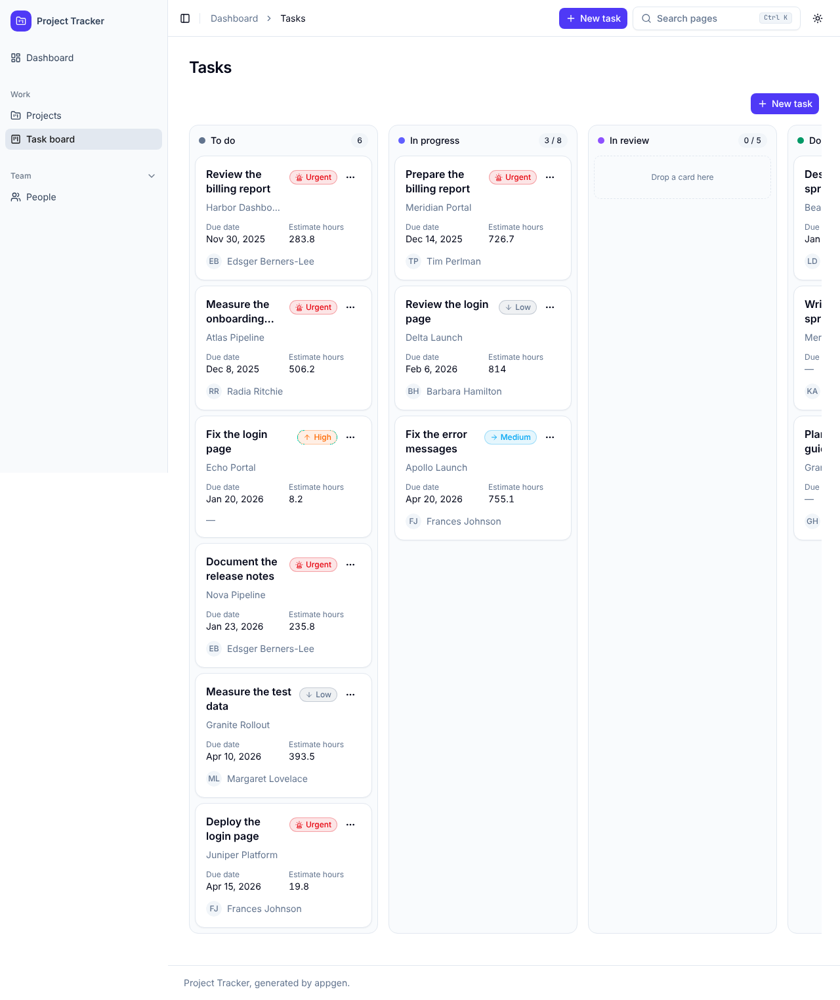
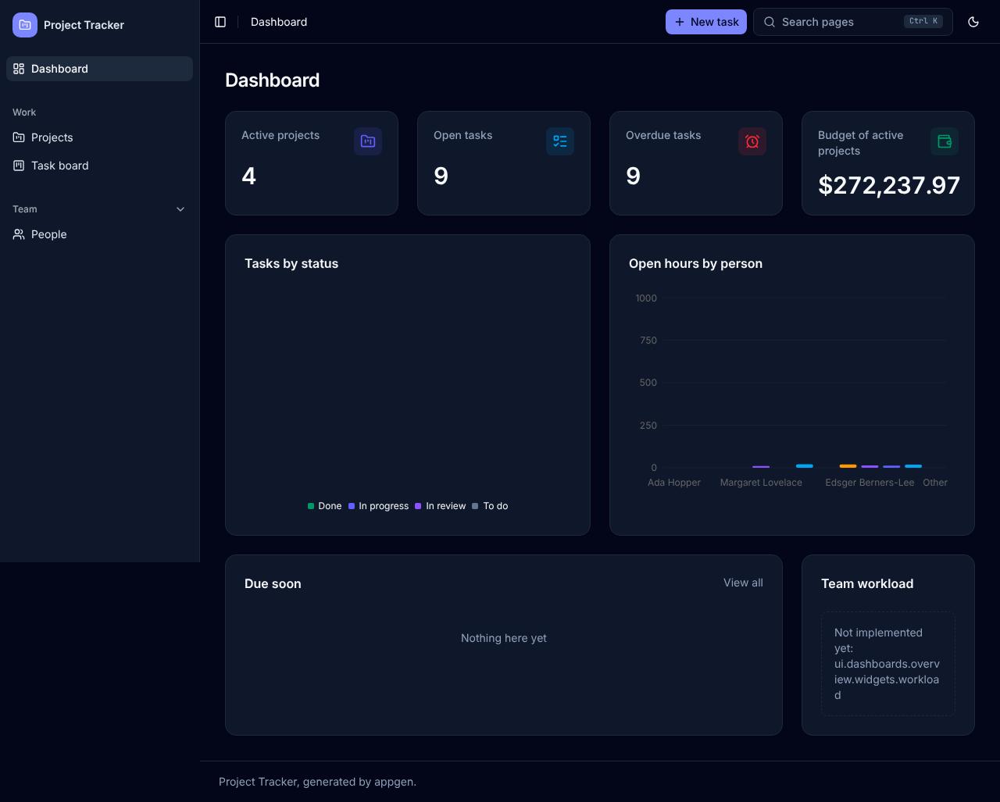
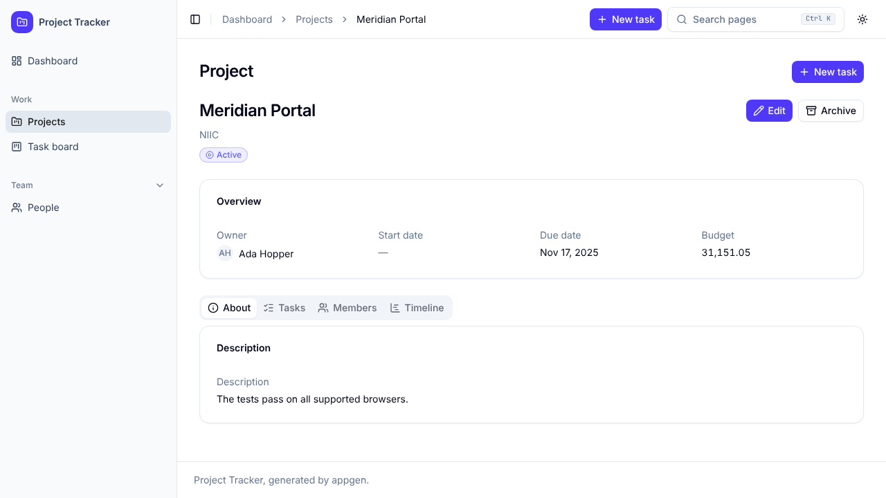
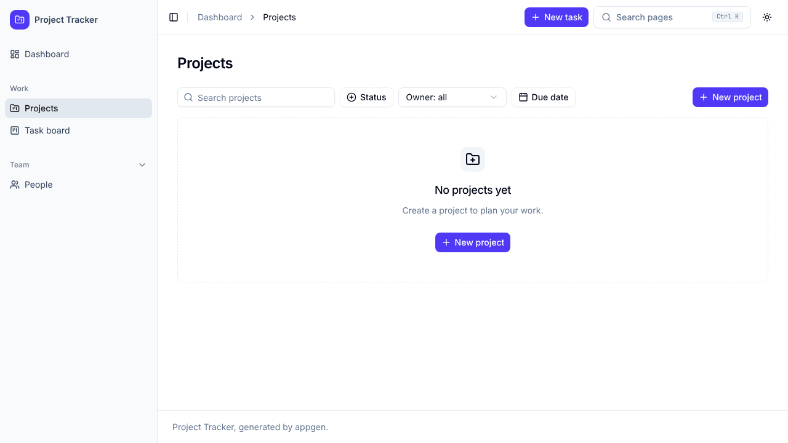

# Evaluation of the proof of concept

This report evaluates the appgen proof of concept (PoC) at the end of
milestone M8. It tells what the PoC proves, with evidence, what it does
not do yet, and the proposed next steps.

## Contents

- [Summary](#summary)
- [What the PoC proves](#what-the-poc-proves)
- [Evidence](#evidence)
- [Limits](#limits)
- [UI details that the DSL cannot describe](#ui-details-that-the-dsl-cannot-describe)
- [Problems found in the generated apps](#problems-found-in-the-generated-apps)
- [Problems found in the tools](#problems-found-in-the-tools)
- [Next steps](#next-steps)

## Summary

One app definition (`examples/project-tracker/app.yaml`, 921 lines)
gives three apps that build, start, and pass their checks:

| App                     | Binding   | Files scanned | Traces | Elements covered | Hand-written stubs |
| ----------------------- | --------- | ----: | -----: | ---------------: | -----------------: |
| Full-stack app          | `nextjs`  |   223 |    921 | 443 of 443       | 8                  |
| Front end, mock data    | `react`   |   187 |    841 | 443 of 443      | 8                  |
| Back end, REST API      | `fastapi` |   108 |    376 | 58 of 58 (`page` and `ui` excluded) | 8   |

The traces work as designed: the checker finds each element in the
code, and after a change to the definition it reports each trace to an
element that does not exist any more. The weakest part is the report of
the gaps: the checker counts an element as covered when generated code
calls a stub, so the report shows 0 open gaps for each app although 8
stubs in each app still have no logic.

## What the PoC proves

1. **One definition, three apps.** The same definition generates a
   Next.js full-stack app, a standalone FastAPI REST API, and a
   standalone React front end with mock data (#69).
2. **The generated apps work.** The pre-push hook generates each app,
   installs, lints, type checks, builds, runs the tests of the app,
   builds the Docker image, starts the app, and sends HTTP requests to
   it (#70).
3. **The UI follows the design tokens.** Playwright opens each page of
   the definition in the light and the dark mode, and checks the color
   tokens, the primary color, and the body font size (#71).
4. **The traces show the drift after a change.** After a change to the
   definition, the generator keeps the hand-written extension files, and
   the checker reports each trace to a renamed or removed element (#72).
5. **The output is deterministic.** Two runs give the same files, byte
   for byte (the binding tests).
6. **A user can start from the docs.** The README, `docs/dsl.md`,
   `docs/traces.md`, and `docs/bindings.md` describe the DSL, the
   traces, and how to write a binding (#73).

## Evidence

### Check output

`appgen check` for each app, on the commit of this report:

```text
nextjs:  223 files, 921 traces. Invalid traces: 0. Uncovered elements: 0. Open gaps: 0.
         all  443  covered, 100.0 %. Result: passed.
react:   187 files, 841 traces. Invalid traces: 0. Uncovered elements: 0. Open gaps: 0.
         all  443  covered, 100.0 %. Result: passed.
fastapi: 108 files, 376 traces. Invalid traces: 0. Uncovered elements: 0. Open gaps: 0.
         all   58  covered, 100.0 %. Excluded kinds: page, ui. Result: passed.
```

`tests/test_end_to_end.py` asserted 100 % coverage for each app.

Update after #151: the checker now reports an element with a `gap`
trace as an open gap, also when generated code calls the stub. The
reports now show the stubs:

```text
nextjs:  Open gaps: 8. all  435 covered, 8 gaps, 98.2 %. Result: passed.
react:   Open gaps: 8. all  435 covered, 8 gaps, 98.2 %. Result: passed.
fastapi: Open gaps: 3. all   55 covered, 3 gaps, 94.8 %. Result: passed.
```

The FastAPI app has 3 stubs (the custom operations), not 8. Its 4
`validation_ext.py` files are optional hooks that accept all records
by default, so their trace is `manual`, not `gap`.
`tests/test_end_to_end.py` asserts the open gaps of each app. The full
FastAPI report is in [traces.md](traces.md#the-text-report).

### The change scenario

`tests/test_definition_change.py` adds a field, renames the entity
`Comment` to `Remark`, and removes the page `people`. For each binding:

- The extension files with hand-written code stay.
- The new field and the new entity are covered.
- The invalid element IDs are exactly `entities.Comment` and
  `pages.people`.

The drift report is in [traces.md](traces.md#after-a-change-to-the-definition).

### Tests

- 656 Python tests (generator, DSL, checker, bindings, end to end, docs).
- The tests of each generated app (pytest for FastAPI, Vitest for the
  front ends).
- The smoke test: one page of each entity on each front end, and
  `/health` and the list endpoint of each entity on the API.
- 20 Playwright tests for each front end (6 pages and 4 token tests,
  in 2 color modes).

### Screenshots

From the Playwright tests (1280 × 720, full page).

The React task board, light mode (mock data):



The React dashboard, dark mode:



The React project detail page, light mode:



The Next.js project list, light mode (empty database):



## Limits

- **Reserved DSL sections.** The DSL reserves `auth`, `access`,
  `workflows`, and `translations`, but no binding implements them. The
  apps have no sign-in, no permissions, no state machines, and one
  language.
- **Custom logic is stubs.** The custom operations (`archive_project`,
  `assign_task`, `complete_task`), the custom form rule, the custom form
  widget, the custom dashboard widget, and the custom detail tabs are
  stubs in extension files. The apps build and run with them, but they
  do nothing or raise an error.
- **The React app has mock data only.** It has no API client for the
  FastAPI app. The two apps are standalone by design.
- **The Next.js app has no seed data.** The UI tests of the Next.js app
  see only empty states and not-found states.
- **One example.** Only the project tracker drives the PoC. Other
  domains can need DSL features that the example does not use.
- **No production hardening.** There is no logging, no rate limits, no
  migrations after the first one, and no deployment.

## UI details that the DSL cannot describe

These details come from the templates, not from the definition:

- The layout of a page: the order and the place of the title, the page
  actions, and the views.
- Responsive behavior: the breakpoints, the board columns on a narrow
  screen, and the collapsed sidebar.
- The animation of the charts, and the motion of dialogs and menus.
- The format of numbers in a detail view (the dashboard shows a
  currency, the detail view shows the same amount without one).
- The page title of a detail page: the page title ("Project") and the
  record name both show as headings.
- Which actions show in the topbar and on the page. On the task board,
  "New task" shows two times.
- The empty state of a view for a record that does not exist (it shows
  "Nothing here yet", not "not found").
- Labels of the breadcrumb that differ from the menu (the breadcrumb
  says "Tasks", the menu says "Task board").
- The illustrations, and the text of the empty states, other than the
  title and the description.

## Problems found in the generated apps

| Problem | App | Effect |
| ------- | --- | ------ |
| The breadcrumb shows the old record name after an edit, until the next navigation. | Next.js, React | The user sees a stale name. |
| A detail page for an unknown ID returns status 200 and shows an empty state. The Delete action shows. | Next.js | No 404, and a confusing page. |
| The sidebar background stops at the height of the viewport on a long page. | Next.js, React | Visible in full-page screenshots. |
| The task board columns go past the right edge of the page with no scroll hint. | Next.js, React | The last column is cut. |
| "New task" shows in the topbar and on the page. | Next.js, React | Two buttons with the same action. |
| The FastAPI report shows 0 open gaps, but the custom operations raise `NotImplementedError`. | FastAPI | The coverage hides work that is not done. The same is true for the front ends. (Update after #151 and #156: the report shows the open gaps, and a call to a stub gives status 501 with problem details. The generated tests check the 501.) |

## Problems found in the tools

| Problem | Effect |
| ------- | ------ |
| The checker counts an element with a generated trace and a gap trace as covered. | "Open gaps" is 0 for all three apps. A team cannot see the open work in the report. [ADR 0005](adr/0005-generation-gaps.md) expects the checker to report these gaps. |
| After a rename, the old extension file stays (for example `app/features/comments/validation_ext.py`). | The developer must move or delete it. The checker reports its traces, but no tool moves the code. |
| The "did you mean" hint of the checker uses the spelling only. | After the rename `Comment` to `Remark`, the hint says `entities.Project`. |
| The Playwright screenshots catch the charts during their animation. | The pie chart shows empty, and the bars are short. |
| The Playwright npm package downloads Chromium 1248, and the sandbox has Chromium 1243. | `PLAYWRIGHT_CHROMIUM_EXECUTABLE` is necessary in the sandbox. |
| The pre-push hook takes many minutes, because it builds three Docker images and runs two browser test suites. | A small change waits for all checks of its area. |
| The sandbox cannot pull from Docker Hub (rate limit) or ghcr.io. | The checks need mirror images in environment variables. |

## Next steps

1. **Report the stubs as open gaps.** Count an element as an open gap
   while its extension file has a `gap` trace, also when generated code
   calls it. This is the most important change: the report must show
   the work that is not done.
2. **Seed data for Next.js.** Generate a seed script from the mock data
   generator of the React binding, and use it in the smoke and UI tests.
3. **Not-found pages.** Generate a 404 for a detail page with an
   unknown ID.
4. **Fix the shell problems.** The stale breadcrumb, the sidebar
   height, the board overflow, and the duplicate actions.
5. **Help with drift.** Make the "did you mean" hint use the rename
   history or the element kind, and add a command that lists orphaned
   extension files.
6. **Stable screenshots.** Turn off the chart animations in the UI
   tests, and add visual comparison against approved screenshots.
7. **Extend the DSL.** Add layout and responsive hints, number formats
   for each view, and then the reserved sections, starting with `auth`
   and `access`.
8. **Connect React to FastAPI.** Add an optional API client for the
   React binding, so the two apps can work together.
9. **A second example.** Write a definition for another domain to test
   the DSL.
10. **Faster checks.** Cache the Docker layers and the pnpm store, and
    run the checks of the three apps in parallel.
